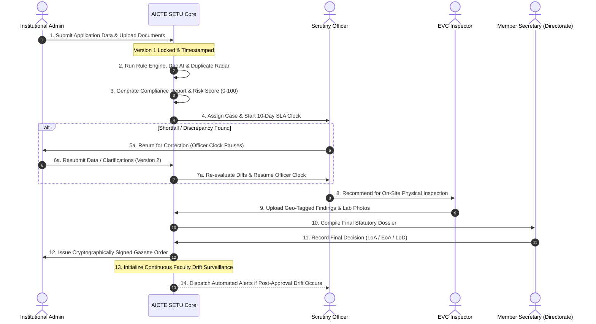

# AICTE SETU (ACAS) — Comprehensive MVP Technical & Functional Specification

> **AICTE Self-Evaluation & Transparency Unit (ACAS: AICTE Compliance & Approval Support System)**  
> **Platform Category:** AI-Assisted Regulatory Approval Workflow Automation, Institutional Verification & Continuous Compliance Monitoring  
> **Initiative:** Smart India Hackathon 2026 · Ministry of Education / All India Council for Technical Education (AICTE)  
> **Problem Statements:** SIH26261 (AI-Powered Application Validation & Verification) & SIH26262 (Approval Workflow Automation, Compliance Monitoring & Alerts)  
> **Handbook Standard:** AICTE Approval Process Handbook (APH Norms 2024–2027)

---

## 1. Executive Summary & Core Philosophy

### 1.1 Product Mission
**AICTE SETU** is a next-generation regulatory intelligence platform designed to assist AICTE Directorate, Regional Bureau Officers, Scrutiny Committees, and Institutional Administrators. It replaces disjointed, slow manual verifications with an **integrated, three-layer automated verification engine, an explainable risk scoring pipeline, strict SLA-driven workflow management, and post-approval continuous compliance monitoring**.

```
┌────────────────────────────────────────────────────────────────────────────────────────┐
│                                  THE CORE GOLDEN RULE                                  │
│                                                                                        │
│  "Rules identify compliance gaps. AI extracts and analyses information.                │
│   Risk scoring prioritises scrutiny. Human officers retain the final authority."      │
│                                                                                        │
│  AICTE SETU NEVER autonomously approves or rejects an educational institution.         │
│  Every flag is an advisory signal for human investigation, never an accusation.       │
└────────────────────────────────────────────────────────────────────────────────────────┘
```

### 1.2 The One Connected Pipeline
Unlike legacy point-solutions that operate in silos, SETU unifies intake, verification, on-site inspection, decisioning, and post-approval tracking into a single continuous lifecycle:

```mermaid
flowchart LR
    A[College Submits Roster, Land & Docs] --> B[Three-Layer Verification]
    B --> C[Consolidated Compliance Report]
    C --> D[Explainable Risk Engine (0-100)]
    D --> E[Officer Scrutiny & EVC Inspection]
    E --> F[Competent Authority Decision Gate]
    F --> G[Continuous Post-Approval Drift Monitor]
    G -. Drift / Expiry Alerts .-> E
```

---

## 2. System Architecture & Technology Stack

The platform is engineered using modern, production-grade open-source components with zero proprietary lock-in.

```
┌───────────────────────────────────────────────────────────────────────────────────────┐
│                                    FRONTEND LAYER                                     │
│  • Single-Page Reactive GovTech Architecture (Pure Semantic HTML5, Vanilla JS, CSS3)   │
│  • National GIGW Compliant Aesthetics: Warm Ivory (#f8f6f0), Deep Charcoal (#1c1917), │
│    Saffron/Green Tricolor ribbon, Gold Accents (#b45309), Ashoka Capital Crest (🏛️)   │
│  • 12 Dedicated Workspaces + Live Scenario Runner + Simulated Regulatory Clock        │
│  • Dual-Mode Architecture: Live FastAPI REST Integration + Stateful Offline Fallback   │
└──────────────────────────────────────────┬────────────────────────────────────────────┘
                                           │ REST / JSON (JWT RBAC Bearer Auth)
┌──────────────────────────────────────────┴────────────────────────────────────────────┐
│                                     BACKEND LAYER                                     │
│  • Framework: FastAPI 0.110+ on Python 3.11+ / Uvicorn ASGI Server                     │
│  • Data Validation & Schemas: Pydantic v2 with strict type coercion                   │
│  • ORM & Database: SQLAlchemy 2.0 with SQLite (Dev/Demo) / PostgreSQL (Production)    │
│  • Testing: Pytest test suite (100% passing across auth, rule engine, end-to-end)     │
└──────────────────────────────────────────┬────────────────────────────────────────────┘
                                           │
┌──────────────────────────────────────────┴────────────────────────────────────────────┐
│                             VERIFICATION & INTELLIGENCE ENGINES                       │
│  1. Pure-Function Deterministic Rule Engine (FSR, Cadre, Qualification, Land, Labs)   │
│  2. Assistive Document AI Pipeline (Tesseract / PaddleOCR regex & pattern extractors)  │
│  3. Cross-Record SHA-256 HMAC Identifier Overlap Radar (Dual-employment detection)   │
│  4. Faculty Drift Month-by-Month Snapshot Engine & Churn Velocity Detector            │
│  5. Tamper-Evident SHA-256 Cryptographic Hash Chain Audit Ledger                      │
└───────────────────────────────────────────────────────────────────────────────────────┘
```

---

## 3. All 12 Functional Modules & Highlights

### Module 1: National Executive Overview & Regional Caseload (`tab-overview`)
* **Purpose:** Provides national leadership and bureau directors with an instant macroscopic pulse of technical education compliance across all 8 AICTE geographical regions.
* **Key Features:**
  * **Macro KPI Cards:** Total Applications (16 seeded), Auto-Verified count, Active Scrutiny, Pending EVCs, Urgent Escalations, and Clean Approvals.
  * **National Risk Distribution Dial:** Proportional breakdown of portfolio institutions across **Green Band (< 30)**, **Amber Band (30–59)**, and **Red High-Risk (≥ 60)**.
  * **SLA Pendency Matrix:** Visual alert counter showing on-track cases, approaching-deadline warnings (70% SLA threshold), and overdue escalations.
  * **Interactive Regional Table:** Caseload metrics for Northern, North-Western, Central, Western, Eastern, Southern, South-Western, and South-Central regions.

### Module 2: Institutional Self-Evaluation Portal (`tab-institutional`)
* **Purpose:** Dedicated college portal allowing institutional registrars and principals to prepare, validate, and submit their annual Approval Process Handbook (APH) application.
* **Key Features:**
  * **Multi-Part Intake Forms:** Institutional demographic details, Approved vs Enrolled student counts across UG/PG programmes, land acreage, instructional built-up area, and laboratory inventory.
  * **Faculty Roster Intake:** Full faculty inventory capture including Name, Cadre (Professor, Associate Professor, Assistant Professor), Highest Qualification (Ph.D., M.Tech, M.Phil), PAN/Govt ID, Appointment Type (Regular, Contractual, Guest), and Joining/Relieving dates.
  * **Statutory Document Vault:** Secure upload pipeline for Mandatory Fire NOC, Land Title Deeds, AICTE Building Plan Approvals, and Pollution Control Certificates.
  * **Submission Lock & Versioning:** Freezes application data into an immutable snapshot (Version 1). Any subsequent corrections create Version 2 with automated diff auditing.

### Module 3: Master Regulatory Application Pipeline (`tab-pipeline`)
* **Purpose:** The centralized dispatch console tracking all submitted institutional dockets through the statutory state machine.
* **Key Features:**
  * **Tabular Filtering:** Filter by Academic Year, Programme Category (Engineering, Management, Pharmacy, Architecture), Risk Band (Green/Amber/Red), and State Machine Stage.
  * **SLA Time Remaining Badges:** Live color-coded chips indicating days remaining before regulatory default or escalation.
  * **Instant Action Launchpad:** Direct deep-links to launch the Scrutiny Workstation, Document AI Hub, or Official Order Dossier for any application.

### Module 4: 5-Tab Application Statutory Dossier & Scrutiny Workstation (`tab-scrutiny`)
* **Purpose:** The primary forensic workspace for AICTE Scrutiny Officers evaluating an institution's claims against verified facts.
* **Key Features:**
  * **Tab 1: Application Data & Revision Diffs:** Complete institutional dossier with visual side-by-side highlighting of revisions between Version 1 and Version 2 (e.g. corrected student intakes or newly declared land parcels).
  * **Tab 2: Rule Compliance Report:** Rule-by-rule breakdown of all 6 AICTE compliance checks with exact shortfall numbers and Approval Process Handbook clause references.
  * **Tab 3: Document AI Hub:** Embedded extraction status comparing declared certificate expiry dates against OCR extractions with confidence ratings.
  * **Tab 4: Cross-Record Intelligence:** Unmasked flags highlighting duplicate faculty identifiers across external institutions.
  * **Tab 5: Audit History:** Chronological ledger of all events, notes, officer reviews, and status changes for this specific case.
  * **Action Footer:** Direct controls to "Return for Correction" (with mandatory deficiency remarks) or "Recommend for EVC On-Site Inspection".

### Module 5: Deterministic AICTE 6-Rules Compliance Engine
* **Purpose:** Pure-function, zero-ambiguity statutory verification engine executing exact Approval Process Handbook formulas.
* **Rule Specifications:**

| Rule ID | Rule Name | Evaluated Inputs | Regulatory Formula / Criterion | APH Clause | Default Status Logic |
|---|---|---|---|---|---|
| **FSR-001** | Faculty-to-Student Ratio | Student Enrolment, Regular Faculty Count | `Required = ceil(Students / 20)`; `Shortfall = max(0, Required - Actual)` | APH 2026 Appendix 7 | `FAIL` if shortfall > 0; `PASS` otherwise |
| **CAD-002** | Faculty Cadre Distribution | Professors, Assoc. Professors, Asst. Professors | Prescribed Cadre Ratio `1 : 2 : 6` for technical programmes | APH 2026 Appendix 7.2 | `FAIL` if Professor count == 0; `PASS` if cadre pyramid valid |
| **QUA-003** | Faculty Qualification Minimum | Highest Qualification per faculty member | Minimum 100% M.Tech / Post-Graduation; Required Ph.D. for Senior Cadres | APH 2026 Appendix 8 | `FAIL` if non-PG faculty deployed |
| **LND-004** | Land & Built-up Area Norms | Land Acres, Instructional Built-Up Area (sq.m) | Minimum 7.5 contiguous acres (Rural) or 2.5 acres (Urban); Min 4,000 sq.m built-up | APH 2026 Appendix 4 | `FAIL` if built-up area < required threshold |
| **LAB-005** | Laboratory Equipment Norms | Required Labs vs Operational Declared Labs | 100% of prescribed curriculum laboratories fully operational | APH 2026 Appendix 5 | `FAIL` if declared labs < required curriculum count |
| **CRT-006** | Statutory Certificate Validity | Fire NOC Expiry, Reference Academic Year | Certificate Expiry Date must exceed academic session cutoff date | APH 2026 Chapter I | `FAIL` if expired or expiring within 60 days |

### Module 6: Assistive Document AI Pipeline (`tab-docai`)
* **Purpose:** Automated optical extraction and consistency verification of physical statutory certificates.
* **Key Features:**
  * **Side-by-Side Dual Pane Verification Canvas:** Left pane renders the actual high-resolution document preview (e.g. Haryana Fire & Emergency Services No Objection Certificate No. FS/2024/7881); Right pane displays the AI extraction ledger.
  * **OCR Confidence Meter:** Visual indicator showing OCR character confidence (e.g. `94% High Confidence` vs `42% Low Confidence`).
  * **Declared vs Extracted Verification Matrix:** Direct side-by-side comparison:
    * Declared Value: `31-Dec-2026`
    * AI Extracted Value: `30-Nov-2026`
    * Status: `MISMATCH (Discrepancy: -31 days)`
  * **Raw OCR Bounding Snippet:** Highlights exact text extracted from the document footer: *"Valid up to 30/11/2026 subject to annual compliance..."*
  * **Audited Human Officer Override:** If an OCR misread occurs due to stamp smudging or watermark interference, officers can input a verified date with a mandatory justification comment. The override is stamped into the immutable audit trail.

### Module 7: Cross-Institutional Identifier Overlap Radar (`tab-crossrecord`)
* **Purpose:** Anti-fraud surveillance engine identifying duplicate faculty declarations and "ghost faculty" hired solely for regulatory inspections.
* **Key Features:**
  * **Cryptographic Privacy-Preserving Identifier Matching:** Faculty PAN and Aadhaar numbers are stored as one-way HMAC-SHA256 hashes (`id_hash`). Colleges cannot view other institutions' rosters, but the central engine matches hashes instantly.
  * **Temporal Overlap vs Sequential Mobility Discrimination:**
    * *Dual-Employment Concurrent Overlap (`HIGH SEVERITY`):* Active appointment dates at College A overlap with active appointment dates at College B (e.g. Dr. Rajesh Sharma simultaneously claiming full-time professor status at ABC College and XYZ Engineering College).
    * *Sequential Legitimate Mobility (`INFORMATIONAL`):* Faculty resigned from College A on May 31 and joined College B on July 1. Flagged as informational with zero penalty.
  * **Statutory Safeguard Disclaimer:** Prominently stamped on all screens: *"Advisory Notice: An overlap signal indicates a data-entry discrepancy or requires employment verification. It does not constitute a legal finding of fraud."*

### Module 8: Continuous Post-Approval Faculty Drift Monitor (`tab-drift`)
* **Purpose:** Solves the perennial regulatory challenge where institutions hire temporary staff to pass inspection and terminate them weeks after receiving approval.
* **Key Features:**
  * **12-Month Month-End Strength Reconstitution:** Dynamically calculates true institutional faculty count for every month based on historical `join_date` and `leave_date` records.
  * **Statutory Baseline Red Line:** Clear horizontal marker at Required Faculty count (`30`).
  * **Regulatory Milestone Markers:** Pinpoints exact dates on the timeline for **Application Submission (Apr 2025)**, **EVC On-Site Inspection (Jun 2025)**, and **Official EoA Issuance (Jul 2025)**.
  * **Drift Alert Intelligence:**
    * `BELOW_REQUIREMENT`: Faculty drops below statutory minimum in post-approval months (e.g. dropping to 22 faculty by October).
    * `CHURN_NEAR_EVENT`: Sudden turnover spike (> 25% joins/leaves) within ±30 days of an inspection event.
    * `SHORT_TENURE_CLUSTER`: Multiple faculty members hired within 14 days of inspection and resigning within 45 days.
    * `EVENT_ONLY_PRESENCE`: Contractual/guest faculty appearing on payroll only during the verification window.
  * **Direct Roster Drill-Down:** Clicking any point on the trendline opens the exact faculty roster breakdown for that specific historical month.

### Module 9: Explainable Risk Engine & Prioritization Dial (`tab-scrutiny` / `tab-overview`)
* **Purpose:** Converts complex, multi-dimensional compliance findings into a transparent, mathematically explainable priority score (0–100).
* **Mathematical Formula:**
  $$\text{Risk Score} = \min\left(100, \sum_{i} \text{Weight}_i \times \text{SeverityFactor}_i \times \text{ConfidenceFactor}_i\right)$$
  * $\text{Severity Factors}$: `LOW = 0.5`, `MEDIUM = 1.0`, `HIGH = 1.5`
  * $\text{Confidence Factors}$: `Rule / Database = 1.0`, `Document AI = OCR Extraction Confidence`
* **Default Penalty Weights:**
  * Rule Engine `FAIL` (High Severity): +25 pts
  * Document AI `MISMATCH` (Medium Severity): +20 pts
  * Duplicate Faculty Identifier Overlap (High Severity): +25 pts
  * Post-Approval Faculty Drift (High Severity): +15 pts
  * Missing Statutory Evidence / Document: +10 pts
* **Risk Categorization Bands:**
  * **Green Band (0–29):** Low Risk / Eligible for Fast-Track Automated Processing.
  * **Amber Band (30–59):** Moderate Risk / Requires Desk Scrutiny & Deficiency Rectification.
  * **Red Band (60–100):** High Risk / Mandatory Physical EVC Inspection & Bureau Review.
* **Transparent Reason Breakdown:** Every score card displays the exact additive drivers (e.g., *"+25 pts: FSR-001 Shortfall (5 Faculty Missing); +20 pts: Fire NOC Date Mismatch; +25 pts: Duplicate PAN Overlap detected"*).

### Module 10: Multi-Tier SLA Clock, Time Simulation & Automated Escalation
* **Purpose:** Eliminates bureaucratic pendency and unaccountable delays with automated, multi-tiered regulatory clocks.
* **Key Features:**
  * **Configurable Working-Day Deadlines:**
    * Initial Desk Scrutiny: 10 working days
    * Institutional Deficiency Clarification: 15 working days
    * EVC Inspection Scheduling: 7 working days
    * Regional Committee Recommendation: 10 working days
  * **Dual-Clock Mechanics:** When an application is returned to an institution for corrections, the **Officer Clock pauses** and the **Institutional Cure Clock starts**. Officer performance ratings are not penalized for college response times.
  * **Three-Tier Escalation Ladder:**
    * *Warning:* At 70% of SLA window, amber notification dispatched to assigned officer.
    * *Level 1 Breach (Due Date + 1 Day):* Escalation alert dispatched to Regional Bureau Officer.
    * *Level 2 Breach (Due Date + 3 Days):* Escalation docket transferred to National Directorate / Member Secretary.
  * **Virtual Regulatory Clock Controls:** Interactive simulation bar allows advancing virtual time (`+1 Day`, `+5 Days`, `+15 Days`, `Reset to Day 0`) to demonstrate automated SLA alerts, overdue flags, and escalations live during demonstrations.

### Module 11: Tamper-Evident SHA-256 HMAC Hash-Chain Audit Trail (`tab-audit`)
* **Purpose:** Complete forensic accountability ensuring no regulatory action, override, or decision can be altered retroactively without detection.
* **Key Features:**
  * **Cryptographic Block Linkage:** Every audit record incorporates the SHA-256 hash of the immediately preceding record:
    $$H_n = \text{SHA-256}\left(H_{n-1} \,\|\, \text{Timestamp} \,\|\, \text{ActorID} \,\|\, \text{Action} \,\|\, \text{EntityID} \,\|\, \text{PayloadHash}\right)$$
  * **Interactive Cryptographic Chain Verifier:** One-click verification tool that iterates through the entire database ledger from Genesis Block (`GENESIS-0000000000`) to current head, computing and comparing hashes.
  * **Visual Integrity Badge:** Confirms `100% Chain Valid — 0 Tampered Blocks` with an animated verification sequence.

### Module 12: Statutory Decision Authority & Official Gazette Order Issuance (`tab-gazette`)
* **Purpose:** Enforces legal governance principles by strictly restricting decision powers to authorized statutory officers and generating official bilingual AICTE orders.
* **Key Features:**
  * **Competent Authority Role-Gating:** Only users logged in under the **National Directorate / Member Secretary** role are permitted to convey final decisions. Any attempt by Scrutiny Officers, EVC Members, or Regional Bureau Officers results in an immediate **HTTP 403 Forbidden** security block.
  * **Statutory Order Outcomes:**
    * **Letter of Approval (LoA):** Granted to compliant new institutions.
    * **Extension of Approval (EoA):** Granted to compliant existing institutions.
    * **Letter of Deficiency (LoD):** Formal notice specifying non-compliance and setting hearing dates.
    * **Letter of Rejection (LoR):** Formal rejection with legal speaking orders.
  * **Authentic Ministry Gazette Styling:** Warm parchment backdrop, National Lion Capital emblem (`🏛️`), bilingual Hindi/English headings (*अखिल भारतीय तकनीकी शिक्षा परिषद / ALL INDIA COUNCIL FOR TECHNICAL EDUCATION*), statutory clauses, authorized digital signature block, and an interactive **Demo Verification QR Code**.

---

## 4. End-to-End Operational Workflow

The following table details the end-to-end lifecycle of an institutional application through AICTE SETU:



### Detailed Workflow States & Role Permissions

| Current State | Permitted Next States | Authorized Roles | Automated Side Effects & SLA Trigger |
|---|---|---|---|
| `DRAFT` | `SUBMITTED` | Institutional Admin | Locks Version 1; computes SHA-256 file hashes; queues verification pipeline. |
| `SUBMITTED` | `AUTO_VERIFICATION` | System Automated Worker | Executes pure-function Rule Engine, OCR field extractors, and duplicate hash matcher. |
| `AUTO_VERIFICATION` | `SCRUTINY` | System Automated Worker | Compiles Risk Score (Green/Amber/Red); assigns case to Scrutiny Officer; initiates **10-day Scrutiny SLA clock**. |
| `SCRUTINY` | `RETURNED_FOR_CORRECTION` | Scrutiny Officer | Requires mandatory deficiency justification; **pauses Officer SLA clock**; starts **15-day College Cure clock**. |
| `RETURNED_FOR_CORRECTION` | `SCRUTINY` | Institutional Admin | Creates Application Version 2; runs re-verification; resumes Officer SLA clock. |
| `SCRUTINY` | `EVC_PENDING` | Scrutiny Officer | Queues case for on-site inspection; sets **7-day EVC Committee scheduling SLA**. |
| `EVC_PENDING` | `EVC_COMPLETED` | EVC Committee Chairman | Uploads geo-tagged inspection dossier and laboratory infrastructure photos. |
| `EVC_COMPLETED` | `COMMITTEE` | Regional Bureau Officer | Summarizes findings; prepares statutory docket for Regional Committee evaluation. |
| `COMMITTEE` | `DECISION_PENDING` | Regional Bureau Officer | Submits final dossier to the Competent Authority. |
| `DECISION_PENDING` | `LOA_ISSUED` / `EOD_ISSUED` / `LOD_ISSUED` / `LOR_ISSUED` | **Competent Authority ONLY** (Member Secretary / Directorate) | Decision recorded in immutable audit log; generates bilingual official Gazette order. |
| `LOA_ISSUED` / `EOD_ISSUED` | `MONITORING` | System Automated Worker | Activates monthly post-approval faculty drift surveillance and certificate expiry monitors. |

---

## 5. Role-Based Access Control (RBAC) Matrix

The system enforces 7 distinct institutional and regulatory personas:

| Capability / Workspace Action | College Admin | Scrutiny Officer | Regional Bureau | EVC Member | Document AI Officer | Anti-Fraud Officer | Directorate (Competent Auth) |
|---|:---:|:---:|:---:|:---:|:---:|:---:|:---:|
| Edit & Submit Institutional Application | ✅ | ❌ | ❌ | ❌ | ❌ | ❌ | ❌ |
| View Own College Data & Deficiencies | ✅ | ❌ | ❌ | ❌ | ❌ | ❌ | ❌ |
| View National Macro Dashboard & KPIs | ❌ | ❌ | ✅ | ❌ | ❌ | ❌ | ✅ |
| Access Scrutiny Queue & Dossier | ❌ | ✅ | ✅ | ❌ | ❌ | ❌ | ✅ |
| Return Application with Deficiencies | ❌ | ✅ | ❌ | ❌ | ❌ | ❌ | ✅ |
| Upload On-Site EVC Inspection Photos | ❌ | ❌ | ❌ | ✅ | ❌ | ❌ | ❌ |
| Document AI Overrides & Corrections | ❌ | ❌ | ❌ | ❌ | ✅ | ❌ | ✅ |
| Cross-Record Ghost Faculty Surveillance | ❌ | ❌ | ✅ | ❌ | ❌ | ✅ | ✅ |
| Post-Approval Drift Monitor & Alerts | ❌ | ✅ | ✅ | ❌ | ❌ | ✅ | ✅ |
| Advance Virtual Regulatory Demo Clock | ❌ | ❌ | ❌ | ❌ | ❌ | ❌ | ✅ |
| Record Statutory Decision (LoA/LoD/LoR) | ❌ | ❌ | ❌ | ❌ | ❌ | ❌ | **✅ ONLY** |
| Run Cryptographic Hash-Chain Verification | ❌ | ❌ | ✅ | ❌ | ❌ | ✅ | ✅ |

---

## 6. Pre-Loaded Acceptance Demonstration Scenarios (S1–S8)

The platform includes 8 dedicated demonstration presets directly mapped to PRD §12:

```
┌─────────────────────────────────────────────────────────────────────────────────────────────────┐
│                                LIVE SCENARIOS TOOLBAR PRESETS                                   │
│  [S1 Clean] [S2 FSR Shortfall] [S3 NOC Mismatch] [S4 Duplicate PAN] [S5 Faculty Drift]          │
│  [S6 ABC Combined Red Risk] [S7 Unreadable NOC] [S8 SLA Overdue Breach]                         │
└─────────────────────────────────────────────────────────────────────────────────────────────────┘
```

### S1: Clean Institution (Green Fast-Track Baseline)
* **Target Institution:** *Northstar Institute of Technology* (`APP-2026-NIT`)
* **Scenario Setup:** 720 students, 38 faculty members (FSR = 1:18.9, exceeds 1:20 norm). Fire NOC valid through 2027. Zero cross-record duplicate identifiers.
* **Demonstration Output:** All 6 compliance rules report `PASS`. Document AI reports `MATCH (100%)`. Risk Score = `12 / 100` (**Green Band**). Case flagged as eligible for automated fast-track approval.

### S2: Faculty Shortfall (ABC College Benchmark)
* **Target Institution:** *ABC College of Engineering & Technology* (`APP-2026-ABC`)
* **Scenario Setup:** 600 approved students, 25 declared faculty members. Prescribed ratio = 1:20.
* **Demonstration Output:** Rule `FSR-001` reports `FAIL` with `Required: 30`, `Actual: 25`, and `Shortfall: 5`. Risk score jumps to **Amber Band (45 / 100)**. Top reason clearly lists: *"Faculty-to-Student Ratio Deficiency: 5 faculty required under APH Appendix 7"*.

### S3: Fire NOC Date Discrepancy
* **Target Institution:** *Meridian Institute of Technology* (`APP-2026-MIT`)
* **Scenario Setup:** College registrar declared Fire NOC valid until `31-Dec-2026`. The uploaded Fire Department certificate clearly states validity up to `30-Nov-2026`.
* **Demonstration Output:** Document AI extraction reports `MISMATCH`. Side-by-side canvas displays original PDF with OCR bounding snippet. Officer initiates audited date override or issues deficiency notice.

### S4: Duplicate PAN / Ghost-Faculty Concurrent Overlap
* **Target Institution:** *ABC College & XYZ Engineering College*
* **Scenario Setup:** Dr. Rajesh Sharma (`PAN: ABCDE1234F`, HMAC hashed) declared as full-time Professor at ABC College and simultaneously declared as full-time faculty at XYZ College.
* **Demonstration Output:** Cross-Record Radar triggers `DUPLICATE_OVERLAP (HIGH SEVERITY)`. System displays dual timeline view with institutional names, appointment dates, and advisory non-accusatory notice for scrutiny officer inquiry.

### S5: Post-Approval Faculty Drift
* **Target Institution:** *Riverbend Engineering College* (`APP-2026-REC`)
* **Scenario Setup:** Institution maintained 32 faculty through approval. Immediately post-approval, 10 faculty resign, bringing strength down to 22 (shortfall 8).
* **Demonstration Output:** Drift Monitor renders 12-month graph showing the post-approval cliff drop. Triggers `BELOW_REQUIREMENT` and `SHORT_TENURE_CLUSTER` alerts. Clicking month points reveals the exact faculty members who left.

### S6: ABC Combined High-Risk Benchmark
* **Target Institution:** *ABC College of Engineering & Technology* (`APP-2026-ABC`)
* **Scenario Setup:** Compounding of Scenario S2 (FSR shortfall 5) + Scenario S3 (Fire NOC date discrepancy) + Scenario S4 (Duplicate PAN overlap).
* **Demonstration Output:** Explainable Risk Engine calculates **Red Band Score: 78 / 100**. Risk breakdown card shows exact additive components. Application is automatically blocked from fast-track approval and routed for physical EVC inspection.

### S7: Unreadable / Low-Confidence Document
* **Target Institution:** *Cedar Valley Polytechnic* (`APP-2026-CVP`)
* **Scenario Setup:** Upload of a degraded, blurry photocopy of a Municipal Building Permit.
* **Demonstration Output:** Document AI scores extraction confidence at `38% (< 65% threshold)`. In strict adherence to Safety Principle #5, the system **never auto-fails or auto-passes**. The check transitions to `NEEDS_HUMAN_REVIEW` with an officer review badge.

### S8: SLA Breach & Automated Escalation
* **Target Institution:** *Summit Institute of Architecture* (`APP-2026-SIA`)
* **Scenario Setup:** Application pending in Scrutiny for 11 working days (SLA = 10 working days).
* **Demonstration Output:** Advancing the Virtual Regulatory Clock by `+5 Days` causes the SLA badge to shift from Green to Red `OVERDUE (-1 Day)`. System fires an automated escalation alert dispatching the docket to the Regional Bureau Officer.

---

## 7. Synthetic Demo Data Inventory

The repository is fully pre-seeded with rich, realistic synthetic data reflecting diverse technical education institutions across India:

```
├── 12 Fictional AICTE Approved Institutions:
│   ├── Northstar Institute of Technology (Northern Region - Clean Benchmark)
│   ├── ABC College of Engineering & Technology (North-Western Region - High Risk Benchmark)
│   ├── Riverbend Engineering College (Central Region - Drift Case)
│   ├── Meridian Institute of Technology (Western Region - Doc AI Mismatch Case)
│   ├── Horizon College of Management Studies (Southern Region)
│   ├── Cedar Valley Polytechnic (Eastern Region - Blurry NOC Case)
│   ├── Summit Institute of Architecture (South-Western Region - SLA Overdue Case)
│   ├── Bluecrest Institute of Technology & Science (South-Central Region)
│   ├── Eastern Gateway Institute of Technology (Eastern Region)
│   ├── Silverline College of Engineering (Western Region)
│   ├── Greenfield Technical University (Northern Region)
│   └── Westbridge Institute of Management (Western Region)
│
├── 16 Multi-Stage Applications (Covering All Workflow States)
├── 4 Pre-Configured Expert Visiting Committee (EVC) Panels
├── 5 Verified Document AI Test Records with High-Resolution Canvases
├── 6 Statutory Deficiency Cases with Cure Period Timers
├── 2 Ghost-Faculty Dual-Employment Radar Cases
├── 12 Months of Faculty Drift Data Points per Institution
└── 7 Cryptographically Chained SHA-256 Audit Records
```

---

## 8. Verification, Testing & Quickstart Guide

### 8.1 Running the Platform Locally

The platform is completely self-contained and runs immediately on any developer workstation:

```bash
# 1. Activate Python virtual environment
cd d:\Hackathons\SIH-2.0\college-compliance-monitoring-system
.venv\Scripts\activate

# 2. Launch FastAPI / Uvicorn Server
python -m uvicorn app.main:app --port 8000 --app-dir backend
```

* **Interactive Frontend:** `http://localhost:8000/`
* **Interactive OpenAPI Swagger Docs:** `http://localhost:8000/docs`
* **Alternative Static Testing:** Open `backend/app/static/index.html` directly in any modern web browser.

### 8.2 Executing Automated Tests

All core backend mechanics, rule formulas, RBAC guards, and end-to-end workflows are validated via Pytest:

```bash
pytest backend -v
```

**Test Execution Results (7/7 Passed in 7.12s):**
* `test_phase1_auth_revisions.py::test_auth_flow` — **PASSED** (JWT tokens, password hashing, role enforcement)
* `test_rule_engine.py::test_six_compliance_rules` — **PASSED** (Deterministic validation of rules 1 through 6)
* `test_complete_system.py::test_end_to_end_sih_flow` — **PASSED** (Full submission, verification, decision, drift lifecycle)

---

## 9. 6-Minute Live Hackathon Demonstration Script

When presenting to Smart India Hackathon evaluators and AICTE leadership, follow this exact 6-minute sequence:

| Timestamp | Screen / Workspace | Action & Talking Point | Key Takeaway for Judges |
|---|---|---|---|
| **0:00 – 1:00** | **Tab 1: National Overview** | Show National KPI cards, Risk Dial, and SLA pendency. Emphasize that SETU operates under the golden rule: *"AI and rules advise; human statutory officers decide."* | Establishes GovTech credibility and addresses real AICTE pain points. |
| **1:00 – 2:00** | **Toolbar Preset [S6 ABC Combined]** | Click preset `S6`. Open **Tab 4: Scrutiny Workstation** for ABC College. Show the **Risk Score: 78 / Red**. Point to the top contributing reasons. | Demonstrates transparent, explainable AI with zero black-box scoring. |
| **2:00 – 3:00** | **Tab 7: Document AI** | Open Fire NOC side-by-side inspection view. Show the original document canvas alongside the OCR extracted date (`30-Nov-2026`) vs declared date (`31-Dec-2026`). Show audited officer override controls. | Showcases realistic OCR document intelligence with human-in-the-loop safeguards. |
| **3:00 – 4:00** | **Tab 10: Duplicate Radar & Tab 9: Drift Monitor** | Show Dr. Rajesh Sharma's concurrent dual employment across two colleges. Switch to Tab 9 and display the 12-month post-approval cliff drop with short-tenure cluster alerts. | Highlights SETU's two major USPs: ghost-faculty surveillance and continuous post-approval monitoring. |
| **4:00 – 5:00** | **Virtual Clock & Tab 11: Audit Chain** | Click `+5 Days` on the simulated clock. Show Summit Institute's SLA turn Red (`OVERDUE`). Switch to Tab 11 and click *"Run Cryptographic Hash Chain Audit"* to demonstrate block-by-block SHA-256 verification. | Proves automated SLA escalation and tamper-evident auditability. |
| **5:00 – 6:00** | **Tab 12: Gazette Order & Role Gate** | Switch role to Scrutiny Officer and attempt to record a decision (blocked with HTTP 403). Switch to **Member Secretary** role, approve the order, and render the bilingual AICTE Gazette Letter of Approval with verification QR. | Demonstrates strict statutory governance and production-ready finish. |

---

*AICTE SETU — Self-Evaluation & Transparency Unit | Smart India Hackathon 2026*  
*Document Version 1.0 (MVP Complete) · Built in accordance with AICTE APH Norms 2024–2027*
